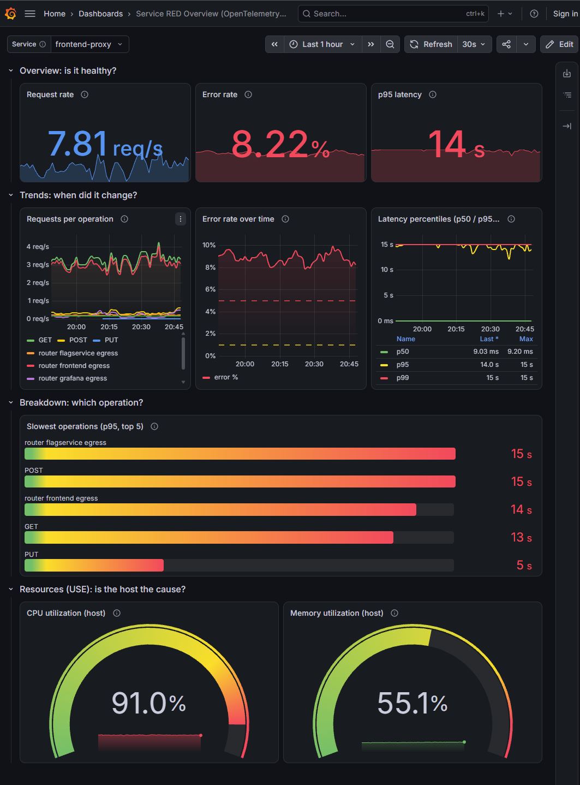

# otel-red-dashboard

A Grafana dashboard + alert rule I built while learning Prometheus and Grafana, using the [OpenTelemetry Demo](https://github.com/open-telemetry/opentelemetry-demo) as a data source. Everything is based on the span metrics the demo's collector generates.

<p align="center">
  
</p>

## What's on it

You pick a service from the dropdown and the dashboard goes from "is something wrong" to "what's causing it":

- Overview: request rate, error %, p95 latency
- Trends: requests per operation, error % over time, p50/p95/p99
- Breakdown: top 5 slowest operations
- Resources: host CPU and memory

RED metrics are at the top since that's what users actually notice. CPU/memory are at the bottom because they're more useful for finding the cause once you already know something is off.

## Queries

Error %:
```promql
(sum(rate(traces_span_metrics_calls_total{service_name="$service", status_code="STATUS_CODE_ERROR"}[5m])) or vector(0))
/ sum(rate(traces_span_metrics_calls_total{service_name="$service"}[5m])) * 100
```

p95 latency:
```promql
histogram_quantile(0.95, sum by (le) (rate(traces_span_metrics_duration_milliseconds_bucket{service_name="$service"}[5m])))
```

A couple of things I ran into while building it:
- My first error % query didn't use `rate()`, so it showed the error rate since startup and didn't react at all when I triggered failures.
- `topk(5, ...)` showed 7 bars until I switched the panel to an instant query, because on a range query the top 5 changes over time.
- Memory showed two values because two sources report the same host, so I filtered it to one `job`.

## Alert

Fires when any service's error rate is above 5% for 5 minutes. One rule covers all services with `sum by (service_name)`. The 5 min pending period is there so it doesn't fire on short spikes.

## Limitations

- CPU and memory are for the whole Docker VM, not per service.
- Span metrics count spans, not HTTP requests, so errors are based on span status.
- Latency thresholds (500ms / 1s) are just a starting point.

## Running it

```bash
git clone https://github.com/open-telemetry/opentelemetry-demo.git
cd opentelemetry-demo
docker compose -f compose.yaml -f compose.observability.yaml up
```

Then open Grafana at `localhost:8080/grafana` and import `dashboard.json` (Dashboards → New → Import).
